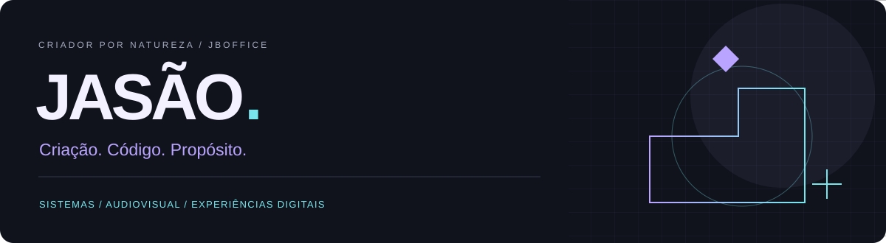

# João Lucas de Oliveira · Jasão

**Um pé no audiovisual. Outro no código. Os dois na criação.**

Sou criador de sistemas, automações e experiências digitais. Gosto de juntar imaginação, interface e engenharia para transformar uma ideia em algo que uma pessoa consiga usar de verdade.

Construo a **JBOFFICE com a Bruna**: um estúdio independente onde criação e tecnologia trabalham juntas. Nosso primeiro case público é a própria experiência do estúdio, com identidade própria, navegação por capítulos e briefing interativo.

[**Explore a JBOFFICE ↗**](https://jboffice.netlify.app) · [LinkedIn](https://www.linkedin.com/in/jasao369/) · [Converse sobre um projeto](https://wa.me/5533999516555)

## O que eu crio

- **Sistemas e automações:** interfaces, fluxos de trabalho, integrações e ferramentas que começam pelo problema a resolver.
- **Experiências digitais:** páginas com direção visual própria, interação útil e cuidado com o celular.
- **Audiovisual:** edição, clipes e fluxos de produção; adaptação PT→EN com materiais e voz autorizados, amostra e revisão.
- **IA aplicada:** apoio à criação, organização e execução, com validação e responsabilidade humana.

## Meu laboratório

**JBOFFICE** — criação e tecnologia com Jasão & Bruna.

**Sistema do Jasão / Sistema Six** — pesquisa e desenvolvimento de sistemas, automação e experiências interativas.

**Universo Z Studio** — ferramentas e fluxos de produção audiovisual.

Também fazem parte da minha trajetória projetos de gestão de infraestrutura, controle de portaria, colaboração e ferramentas para músicos, como o CifrAstral. Os sistemas internos e os materiais de clientes não são publicados aqui.

## Como eu trabalho

Entender o contexto → definir o escopo → construir uma amostra → testar → revisar.

Uso React, TypeScript, Python, FastAPI, Firebase, Electron e ferramentas de mídia conforme o projeto. A tecnologia serve à entrega; a entrega precisa ser conferida.

Gosto de sistemas com personalidade, mas personalidade não substitui funcionamento. Prefiro mostrar um trabalho próprio e combinar critérios de aceite a prometer automação ilimitada ou resultado financeiro garantido.

## Vamos criar algo que tenha a sua cara?

**Portfólio:** https://jboffice.netlify.app  
**Contato profissional:** joaolucas.oliveira.griffin@gmail.com  
**LinkedIn:** https://www.linkedin.com/in/jasao369/

> Criar é dar forma ao que ainda não existe — e cuidar para que funcione.
